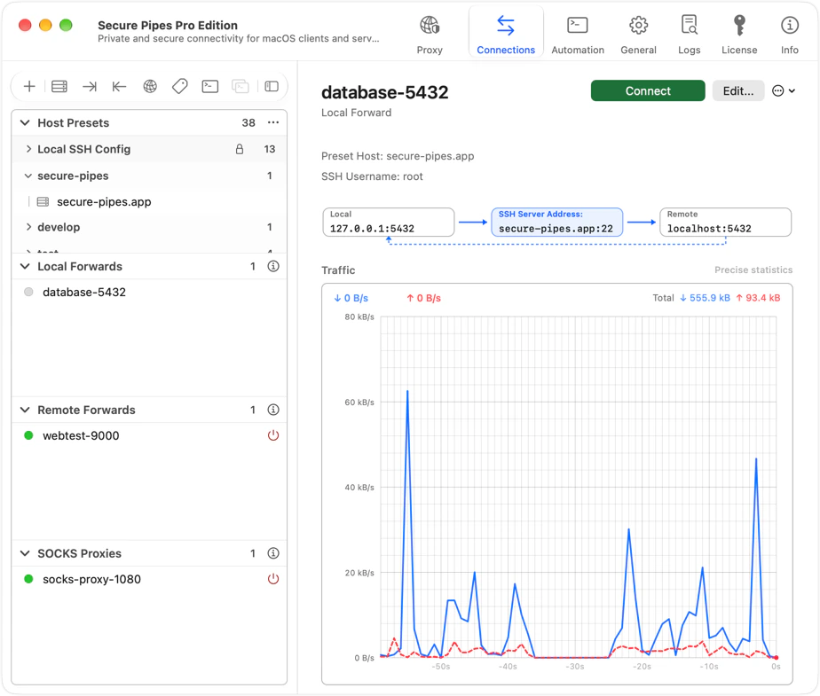

# Secure Pipes 2


Secure Pipes is a native macOS SSH tunnel and proxy manager with local and remote port forwarding, SOCKS5/HTTP proxies, per-app routing rules, DNS caching, SFTP, and an integrated terminal.

Requires macOS 12 or later. Supports Apple silicon and Intel Macs.

Install with [Homebrew](https://brew.sh):

```sh
brew install --cask secure-pipes
```



This repository is for bug reports and feature requests. Use the issue templates to describe reproducible problems or suggest improvements.

- Website and downloads: [secure-pipes.app](https://secure-pipes.app)
- Documentation: [AppleScript and spcli guides](docs/readme.md)
- Contributing: [Reporting issues and improving documentation](CONTRIBUTING.md)
- Security: [Report a vulnerability privately](SECURITY.md)
- Support: [support@secure-pipes.app](mailto:support@secure-pipes.app)

<a href="https://secure-pipes.app"></a>

Do not post credentials, private keys, license keys, sharing QR codes, or unredacted configuration backups in public issues.
